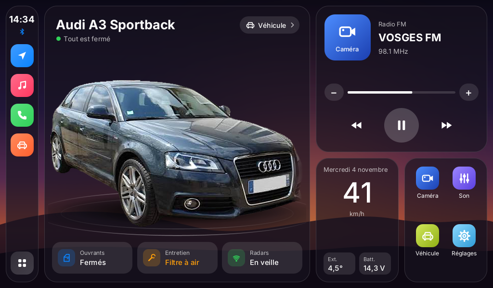
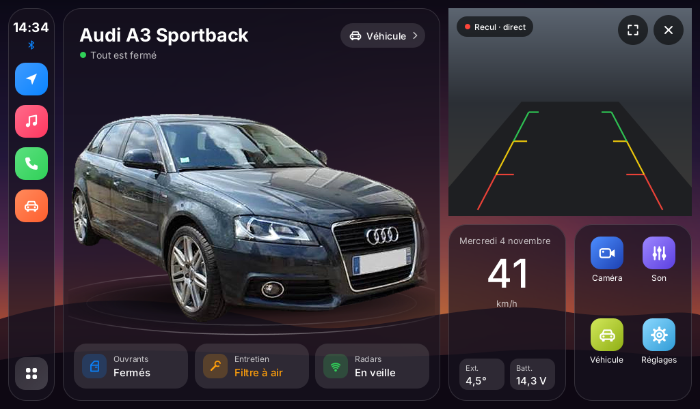
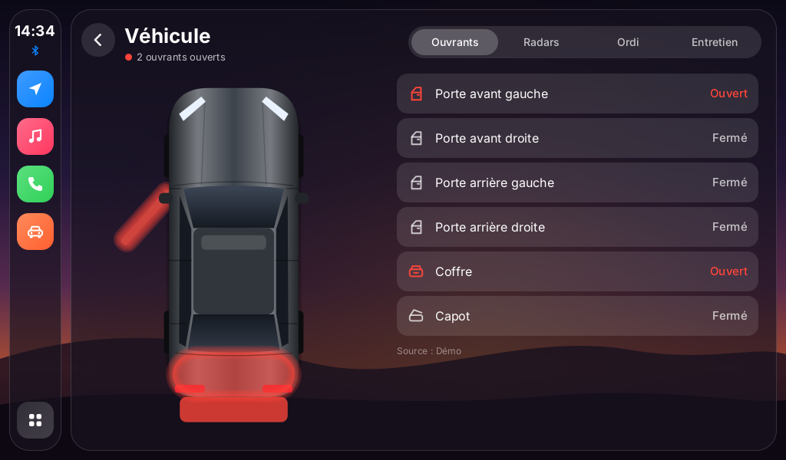
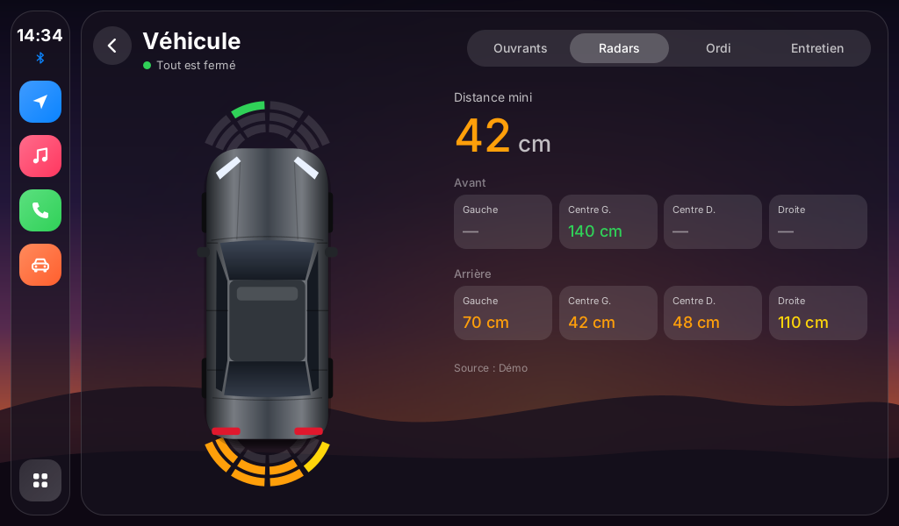
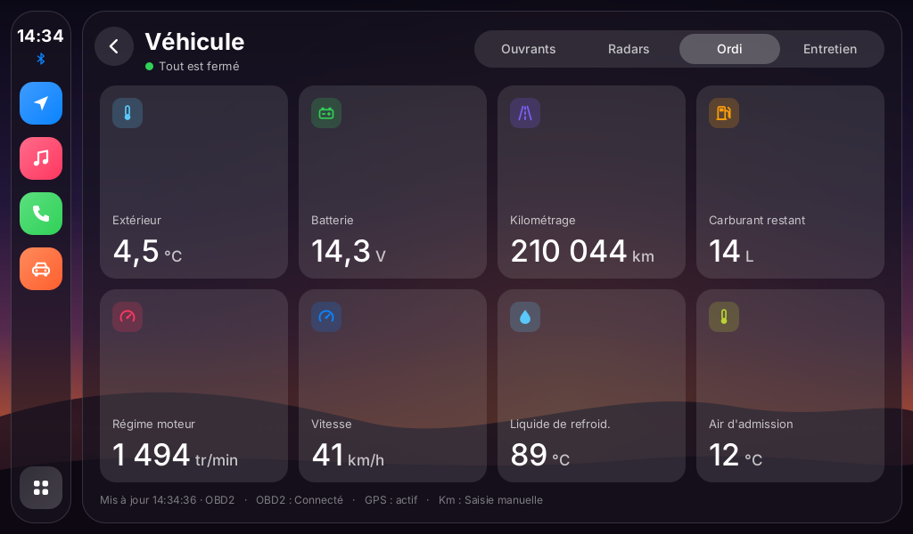
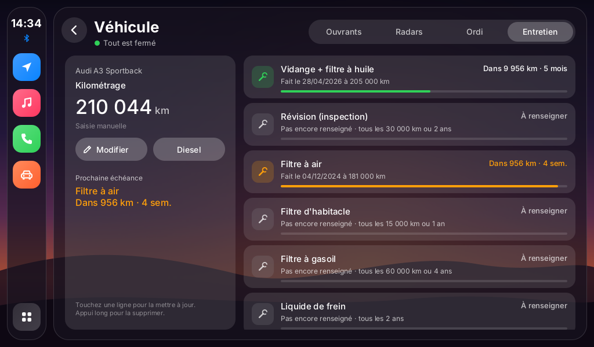

# A3 Cockpit

Écran d'accueil (launcher) pour autoradio Android 12, inspiré de la vidéo TikTok :
voiture sur plateau, multimédia, vitesse, raccourcis, et une page **Véhicule** avec les onglets
**Ouvrants / Radars / Ordi / Entretien**.

Conçu pour une **Audi A3 8P Sportback (2011, gris Daytona)** et un autoradio **Junsun** MT8163 · 1024×600 ·
boîtier CAN HRD (LuZheng/HaoZheng → Audi → A3). L'accueil affiche la photo détourée de l'A3 vue de 3/4,
posée sur un plateau. Réglages → *Apparence de la voiture* : photo de mon A3, dessin vectoriel
(profil d'après les cotes réelles de l'A3 8PA phase 2), ou une autre photo de la galerie.
L'interface se met à l'échelle de n'importe quel écran paysage.





| Ouvrants | Radars |
|---|---|
|  |  |
| **Ordi de bord** | **Entretien** |
|  |  |

*(Aperçus générés sur PC avec des données de démonstration.)*

## Installation

1. Copier `A3Cockpit.apk` sur une clé USB (ou le télécharger depuis l'autoradio).
2. L'ouvrir avec le gestionnaire de fichiers et autoriser l'installation d'applis inconnues.
3. Lancer **A3 Cockpit**, accepter la localisation (pour la vitesse GPS).
4. Pour qu'il remplace l'accueil : *Réglages → Écran d'accueil par défaut → A3 Cockpit*
   (ou appuyer sur le bouton Accueil et choisir « A3 Cockpit » → « Toujours »).

## Caméra de recul en direct

Le bouton bleu **Caméra** (en haut à droite, et dans les raccourcis) remplace la radio : il affiche
l'image de la caméra de recul **directement dans le cadre**, à tout moment, même en roulant. Les boutons
du cadre permettent de passer en plein écran ou de fermer. L'état est mémorisé (la caméra revient
à l'ouverture de l'accueil si vous l'aviez laissée allumée).

Réglages → *Caméra de recul* : méthode d'accès (Auto / Camera2 / Camera1), numéro de caméra,
lignes de guidage, image miroir, remplir le cadre, appli caméra de secours, liste des caméras détectées.

À savoir :

- Selon le firmware Junsun, l'entrée recul est vue par Android comme une caméra normale (ça marche
  directement) ou réservée à l'appli d'origine. Dans ce cas, essayez un autre numéro / Camera1, sinon
  choisissez l'appli caméra de l'autoradio comme secours.
- **Pour voir l'image en roulant, la caméra doit être alimentée en permanence** (+APC / ACC). Si elle
  est branchée sur le feu de recul, elle n'a du courant qu'en marche arrière.
- L'accueil libère la caméra dès qu'une autre appli passe au premier plan, pour ne pas gêner l'écran
  de recul d'origine.

## Ce que fait chaque écran

- **Dock** (à gauche) : heure, Navigation, Musique, Téléphone, Véhicule, tiroir d'applis.
  Les applis associées se choisissent dans *Réglages → Raccourcis* (détection automatique sinon).
- **Accueil** : voiture (touchez-la pour un reflet), état des ouvrants, carte multimédia
  (bouton caméra, titre en cours, précédent / lecture / suivant, volume), vitesse, température
  extérieure, tension batterie, raccourcis Caméra / Son / Véhicule / Réglages.
- **Ouvrants** : vue de dessus, les portes s'ouvrent et s'allument en rouge.
- **Radars** : zones avant/arrière colorées selon la distance, distance mini.
- **Ordi** : extérieur, batterie, kilométrage, carburant, régime, vitesse, liquide de refroidissement,
  air d'admission.
- **Entretien** : kilométrage, échéances (vidange, révision, filtres, distribution, contrôle
  technique…) en km et/ou en mois, barre de progression, « Fait aujourd'hui », ajout/suppression.
- **Réglages** : nom, 3 portes / Sportback, couleur, **photo de votre voiture** (PNG détouré
  conseillé), réservoir, adaptateur OBD2, mode démo, plein écran…

## D'où viennent les données ?

| Donnée | Source |
|---|---|
| Vitesse | GPS de l'autoradio (ou OBD2 si connecté) |
| Kilométrage | valeur saisie une fois, puis augmentée par le GPS (corrigeable à tout moment) |
| Régime, températures, batterie, carburant | adaptateur **OBD2 ELM327 Bluetooth** (≈ 10 €) branché sous le volant, à appairer puis choisir dans *Réglages* |
| Titre en cours | accès aux notifications (*Réglages → Titres en cours de lecture*) |
| Portes, coffre, capot, radars | voir ci-dessous |

**Portes et radars :** ces infos passent par le boîtier CAN vers le MCU de l'autoradio, qui ne les
partage pas avec les applis Android. L'appli les affiche donc :

- en **mode démo** (pour voir l'animation) ;
- ou si une autre appli (Tasker, passerelle CAN…) envoie la diffusion
  `com.guillaume.a3cockpit.VEHICLE_DATA` avec les extras :
  `door_fl`, `door_fr`, `door_rl`, `door_rr`, `trunk`, `hood` (true/false),
  `radar_front`, `radar_rear` (4 distances en cm, ex. `"80,45,50,120"`),
  `speed`, `rpm`, `coolant`, `intake`, `ambient`, `battery`, `fuel_l`, `fuel_pct`, `odometer`.

Exemple de test via ADB :

```sh
adb shell am broadcast -a com.guillaume.a3cockpit.VEHICLE_DATA --ez door_fl true --es radar_rear "60,40,45,90"
```

## Compiler

Sans Gradle, avec les outils Android de Debian/Ubuntu :

```sh
sudo apt install aapt android-sdk-platform-23 dalvik-exchange zipalign apksigner openjdk-17-jdk
./build.sh
```

L'APK est signé avec `signing/a3cockpit.jks` (mot de passe `a3cockpit`) : gardez ce fichier pour que
les mises à jour s'installent par-dessus l'ancienne version.
