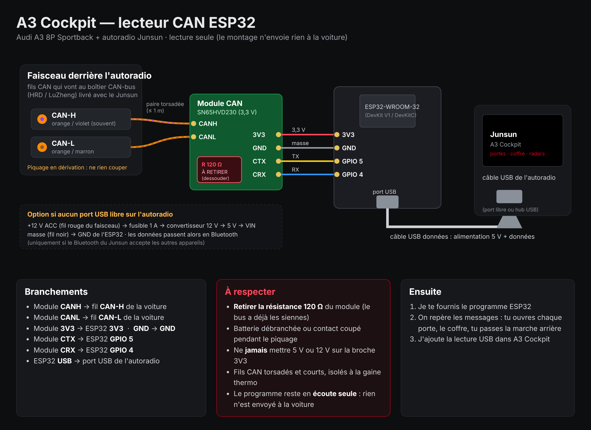

# Lecteur CAN ESP32 (projet à terminer)

But : afficher dans A3 Cockpit l'état réel des portes, du coffre, du capot et des radars.

## Pièces (≈ 15 à 20 € sur AliExpress)

| Pièce | Mots-clés AliExpress |
|---|---|
| ESP32-WROOM-32 DevKit V1 (CP2102 ou CH340) | `ESP32 DevKit V1 WROOM-32 CP2102` |
| Module CAN SN65HVD230 (3,3 V) | `SN65HVD230 CAN module` |
| Câble USB **données** 1 m | `micro USB data cable 1m` / `USB type C data` |
| Fils Dupont femelle-femelle | `dupont wire female female 20cm` |
| Gaine thermo, ruban tissu, petit boîtier | `heat shrink kit`, `tesa cloth tape`, `project box 70x45x30` |
| Option sans port USB libre : MP1584 + porte-fusible 1 A | `MP1584 step down 5V`, `inline fuse holder 1A` |

## Câblage

- Module CANH → fil CAN-H (orange/violet en général), module CANL → fil CAN-L (orange/marron), en dérivation sur les fils du boîtier CAN-bus du Junsun.
- Module 3V3 → ESP32 3V3, GND → GND, CTX → GPIO 5, CRX → GPIO 4.
- ESP32 USB → port USB de l'autoradio (alimentation + données).
- Retirer la résistance 120 Ω du module. Programme en écoute seule.
- Si la lecture est mauvaise (CAN basse vitesse), remplacer le SN65HVD230 par un TJA1055.

## Étapes restantes

1. Programme ESP32 (TWAI 100 kbit/s, écoute seule, envoi des trames en USB série).
2. Repérage des messages : ouvrir chaque porte, coffre, capot, passer la marche arrière.
3. Lecture USB série dans A3 Cockpit → `VehicleState`.
