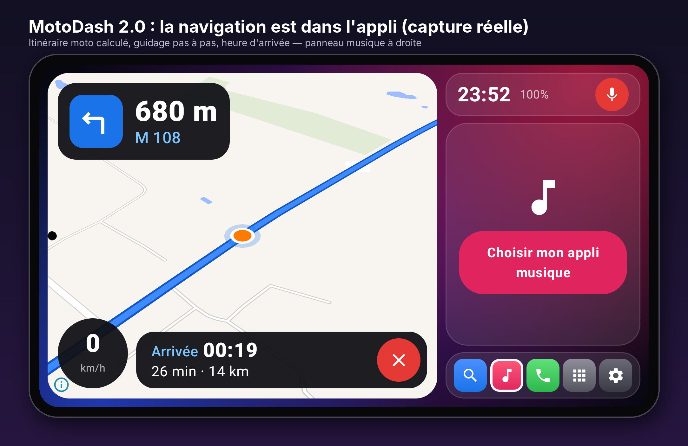

# MotoDash

Tableau de bord moto pour Android, façon CarPlay, à l'horizontale. **La navigation est intégrée** : plus besoin de Waze, la carte remplit exactement le grand cadre arrondi et rien n'est caché.



## Ce que fait l'appli

- **Carte** OpenStreetMap (OpenFreeMap), gratuite, sans compte ni clé.
- **Itinéraires moto** calculés par Valhalla (profil moto), avec options « éviter les autoroutes » et « éviter les péages ».
- **Guidage pas à pas** :
  - prochaine manœuvre (flèche, distance, nom de rue), heure d'arrivée, temps et distance restants ;
  - **voix en français**, la musique baisse pendant les annonces ;
  - **recalcul automatique** si tu sors de l'itinéraire.
- **Destination** : tape-la, **dicte-la** (micro), ou choisis-la dans tes favoris ☆ et destinations récentes. Une adresse partagée depuis une autre appli (« Ouvrir avec MotoDash ») lance aussi le guidage.
- **Panneau de droite** :
  - l'heure, la batterie, l'assistant vocal ;
  - la musique (YT Music, Spotify… : pochette, titre, commandes), les appels (favoris), tes applis ;
  - les réglages.
- **Écran toujours allumé.** Le GPS reste actif pendant un guidage, même écran verrouillé.

## Réglages

- **Carte nord en haut** (activé par défaut) : la carte reste fixe. Désactive-le pour que la carte tourne dans le sens de la marche.
- **Guidage vocal**, **éviter les autoroutes**, **éviter les péages**.
- **Appli musique**, et **accès au titre en cours**.

## Installer

1. Désinstalle l'ancienne version de MotoDash (la nouvelle n'a plus besoin des anciennes autorisations).
2. Copie `MotoDash.apk` sur le téléphone et ouvre-le (autorise « Installer des applis inconnues »).
3. Accepte la **localisation**.
4. Choisis ton **appli musique**. Pour voir le titre en cours : **Réglages → Applis → MotoDash → ⋮ → Autoriser les paramètres restreints**, puis, dans MotoDash, « Autoriser l'affichage du titre ».

Plus besoin d'« afficher par-dessus les autres applis », de l'accès aux données d'utilisation, de l'accessibilité ni des fenêtres de forme libre.

## Limites

- **Pas d'alertes communautaires** (radars, police, accidents, bouchons signalés) : c'est propre à Waze.
- Les services de carte, d'itinéraire et de recherche sont **gratuits et publics**. Il faut du réseau mobile, et ils peuvent être lents ou indisponibles par moments.
- Une **voix française** doit être installée sur le téléphone (Réglages → Synthèse vocale).

## Compiler et tester

```bash
./gradlew assembleRelease        # → app/build/outputs/apk/release/app-release.apk
./gradlew testReleaseUnitTest    # tests du guidage sur un vrai itinéraire moto
```

Carte © OpenStreetMap, OpenFreeMap · Itinéraires : Valhalla · Recherche : Photon / Nominatim
