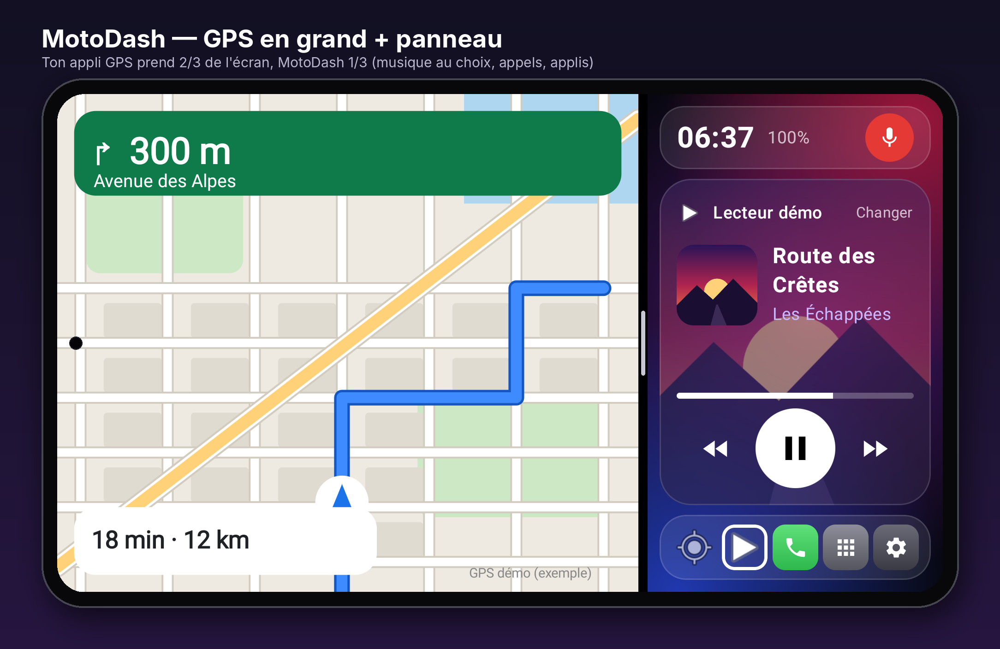

# MotoDash

Tableau de bord moto pour Android, façon CarPlay, directement sur l'écran du téléphone.

**Ton appli GPS** (Waze, Google Maps, Calimoto…) prend la grande partie de l'écran. **MotoDash** tient dans un panneau sur le côté : fond dégradé, cartes en verre dépoli, gros boutons utilisables avec des gants.



## Ce que contient le panneau

- **En haut** : l'heure, la batterie et le bouton micro de l'assistant vocal.
- **La carte Musique** pour l'appli de ton choix (Spotify, Deezer, YouTube Music…) : pochette, titre, artiste, barre de progression et précédent / lecture / suivant. Touche la pochette pour ouvrir l'appli musique.
- **Le dock** :
  - **GPS** rouvre ton appli GPS à côté. Un appui long permet de changer d'appli.
  - **Musique** et **Appels** (contacts favoris en un seul appui).
  - **Applis** : tes raccourcis.
  - **Réglages** : appli GPS, appli musique, ouverture du GPS au démarrage.

L'écran reste allumé et MotoDash s'affiche par-dessus l'écran verrouillé.

## Installer

1. Copie `MotoDash.apk` sur le téléphone et ouvre-le (autorise « Installer des applis inconnues »).
2. Choisis ton **appli GPS**. MotoDash propose d'abord celles qu'il a détectées.
3. Choisis ton **appli musique**, puis touche « Autoriser l'affichage du titre » et active MotoDash dans « Accès aux notifications ».

## Le GPS en grand

Au lancement, MotoDash ouvre ton GPS **en écran partagé**, à côté de lui. Sur Android 12L et plus, l'écran se partage normalement tout seul.

- **Pour agrandir le GPS**, fais glisser la barre du milieu vers MotoDash (2/3 pour le GPS, 1/3 pour MotoDash).
- **Si le GPS est du mauvais côté**, touche deux fois la barre du milieu pour échanger les côtés.
- **Si l'écran ne se partage pas tout seul** : ouvre MotoDash, puis **Récents**, touche l'icône MotoDash, puis **Écran partagé**, et choisis ton GPS.

## Compiler

```bash
./gradlew assembleRelease   # → app/build/outputs/apk/release/app-release.apk
```
