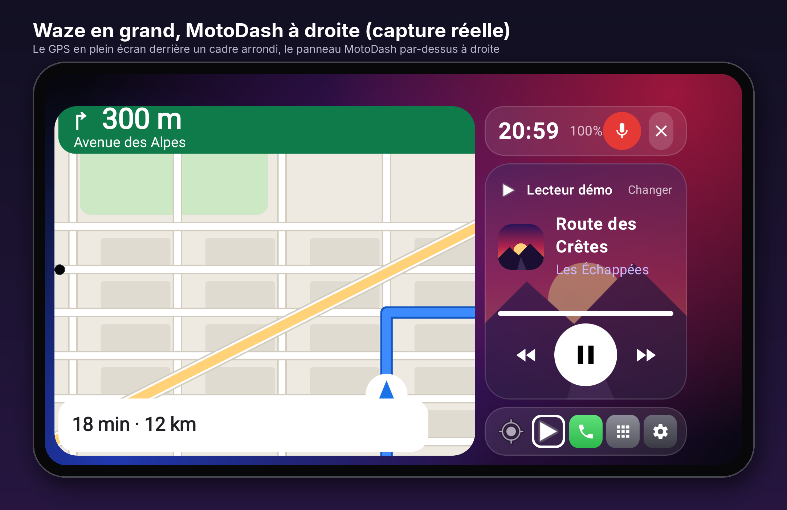

# MotoDash

Tableau de bord moto pour Android, façon CarPlay, directement sur l'écran du téléphone, à l'horizontale.

**Ton appli GPS** (Waze, Google Maps, Calimoto…) s'affiche en grand dans un cadre arrondi, et **MotoDash** est à droite : heure, musique, appels, applis, avec la barre d'icônes en bas du panneau.



## Comment ça marche

- MotoDash ouvre le GPS **en plein écran**, puis dessine par-dessus le panneau de droite et le contour arrondi. Les touches sur la carte vont au GPS, celles sur le panneau vont à MotoDash.
- Le GPS croit occuper tout l'écran : **son tiers droit passe sous le panneau**. Chez Waze, ce sont la fin de la barre « Arrivée … km » et le bouton « signaler » (tu peux signaler à la voix).
- **Le panneau se cache** dès que tu quittes le GPS (accueil, applis récentes, autre appli) et revient quand tu y retournes.
- **Le ✕** en haut du panneau (ou la notification « MotoDash est affiché ») le ferme.
- Réglages → « Écran partagé » remet le mode moitié-moitié d'Android si tu préfères voir le GPS en entier.

## Installer

1. Copie `MotoDash.apk` sur le téléphone et ouvre-le (autorise « Installer des applis inconnues »).
2. Choisis ton **appli GPS** et ton **appli musique**.
3. Touche **Démarrer**, puis :
   - autorise MotoDash à **s'afficher par-dessus les autres applis** ;
   - active MotoDash dans **Accès aux données d'utilisation** (pour cacher le panneau hors du GPS).
4. Pour voir le titre en cours : **Réglages → Applis → MotoDash → ⋮ → Autoriser les paramètres restreints**, puis, dans MotoDash, « Autoriser l'affichage du titre ».

Les options « Fenêtres de forme libre » et « Accessibilité → MotoDash » ne servent plus. Tu peux les désactiver.

## Ce que contient le panneau

- **En haut** : l'heure, la batterie, le micro de l'assistant vocal et le ✕.
- **La carte Musique** pour l'appli de ton choix : pochette, titre, artiste, progression, précédent / lecture / suivant.
- **La barre d'icônes** : GPS, Musique, Appels (contacts favoris), Applis, Réglages.

## Compiler

```bash
./gradlew assembleRelease   # → app/build/outputs/apk/release/app-release.apk
```
