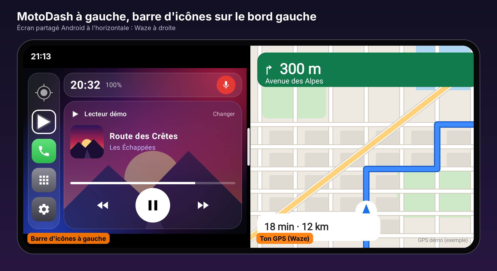
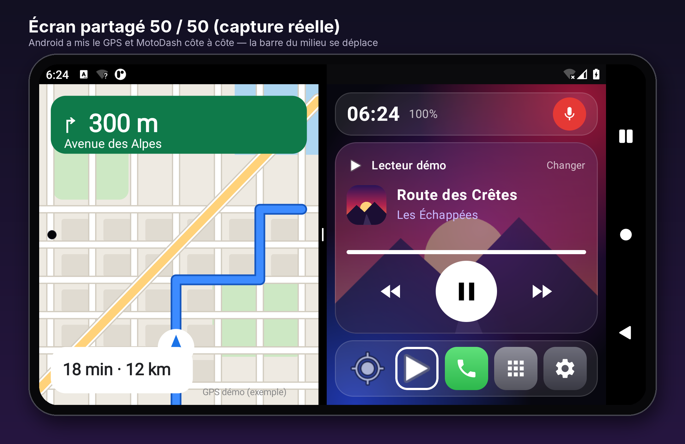
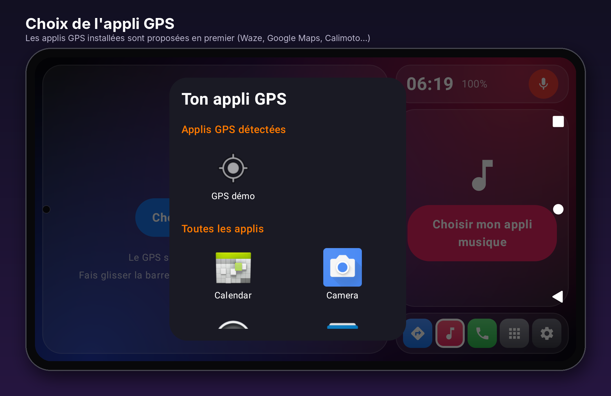

# MotoDash

Tableau de bord moto pour Android, directement sur l'écran du téléphone, à l'horizontale.

**Ton appli GPS** (Waze, Google Maps, Calimoto…) et **MotoDash** s'affichent côte à côte en **écran partagé Android**. Tu fais glisser la barre du milieu pour agrandir le GPS. Waze s'adapte toujours à sa fenêtre, donc rien n'est caché.



## Utilisation

1. Ouvre MotoDash, téléphone à l'horizontale.
2. MotoDash ouvre ton GPS **en écran partagé**. Sur Android 12L et plus, l'écran se partage tout seul.
3. **Pour agrandir le GPS**, fais glisser la barre du milieu vers MotoDash.
4. **Pour mettre le GPS de l'autre côté**, touche deux fois la barre du milieu.
5. **Si l'écran ne se partage pas tout seul** : ouvre MotoDash, puis Récents, touche l'icône MotoDash, puis **Écran partagé**, et choisis ton GPS.

## Ce que contient le panneau MotoDash

- **En haut** : l'heure, la batterie et le bouton micro de l'assistant vocal.
- **La carte Musique** pour l'appli de ton choix (Spotify, Deezer, YouTube Music…) : pochette, titre, artiste, barre de progression et précédent / lecture / suivant. Touche la pochette pour ouvrir l'appli musique.
- **Le dock** :
  - **GPS** rouvre ton appli GPS à côté. Un appui long permet de changer d'appli.
  - **Musique** et **Appels** (contacts favoris en un seul appui).
  - **Applis** : tes raccourcis.
  - **Réglages** : appli GPS, appli musique, ouverture du GPS au démarrage.

L'écran reste allumé et MotoDash s'affiche par-dessus l'écran verrouillé.

## Installer

1. Copie `MotoDash.apk` sur le téléphone et ouvre-le (autorise « Installer des applis inconnues »).
2. Choisis ton **appli GPS** et ton **appli musique**. MotoDash propose d'abord celles qu'il a détectées.
3. Pour voir le titre en cours, MotoDash a besoin de « l'accès aux notifications ». Android 13+ le bloque pour les applis installées hors du Play Store :
   - **Réglages → Applis → MotoDash → ⋮ (en haut à droite) → Autoriser les paramètres restreints** ;
   - puis, dans MotoDash, touche « Autoriser l'affichage du titre » et active MotoDash.

Les options « Fenêtres de forme libre », « Accessibilité → MotoDash » et « Afficher par-dessus les autres applis » ne servent plus. Tu peux les désactiver.

## Compiler

```bash
./gradlew assembleRelease   # → app/build/outputs/apk/release/app-release.apk
```

## Rendus

| Écran partagé 50 / 50 (capture réelle) | Premier lancement |
|---|---|
|  |  |
| **Choix de l'appli GPS** | **Choix de l'appli musique** |
|  |  |

*Les rendus utilisent une fausse appli GPS et un faux lecteur créés pour les captures. Sur ton téléphone, ce sont tes vraies applis (Waze, Spotify…).*
