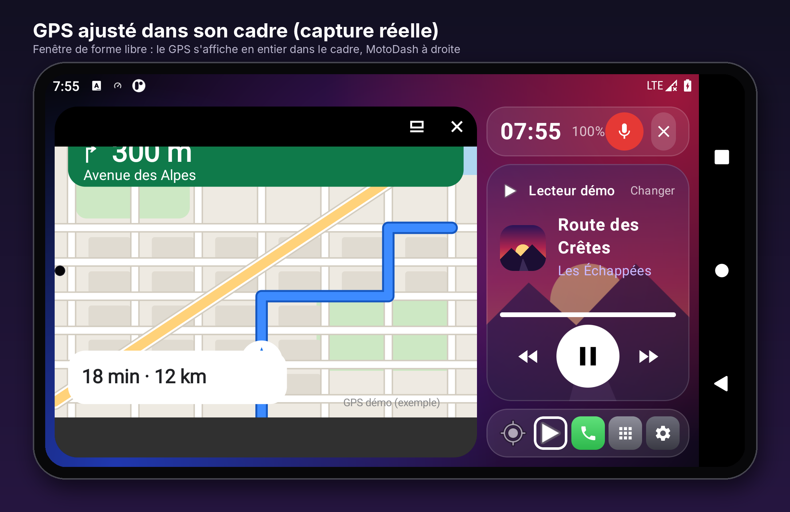
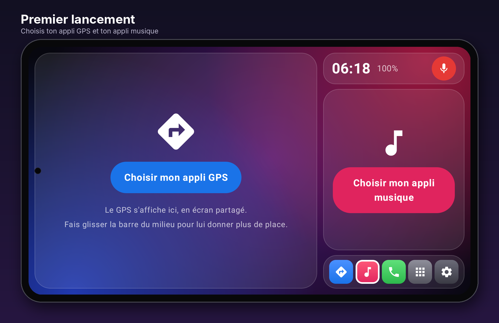
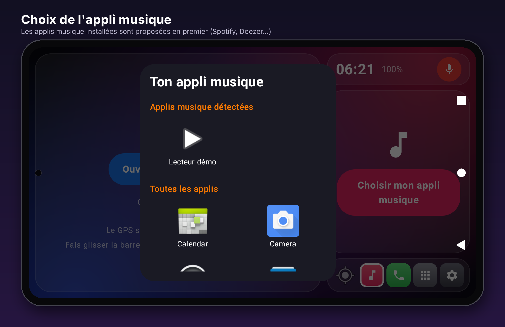

# MotoDash

Tableau de bord moto pour Android, façon CarPlay, directement sur l'écran du téléphone.

**Ton appli GPS** (Waze, Google Maps, Calimoto…) s'ouvre en grand, et **MotoDash** s'affiche à côté dans un panneau : fond dégradé, cartes en verre dépoli, gros boutons utilisables avec des gants.


## Deux façons d'afficher le GPS (Réglages)

- **Par-dessus le GPS, comme CarPlay (par défaut).** MotoDash ouvre le GPS puis s'affiche par-dessus, dans le tiers droit, avec un cadre arrondi autour de la carte. Les touches sur la carte vont au GPS, celles sur le panneau vont à MotoDash. Le ✕ du panneau (ou la notification) le ferme.
  - **Le panneau se cache** dès que tu quittes le GPS (accueil, applis récentes, autre appli) et revient quand tu y retournes. Il faut pour ça activer MotoDash dans « Accès aux données d'utilisation » (demandé au premier démarrage).
  - **Le GPS ajusté dans son cadre** : active « Fenêtres de forme libre » dans les options pour les développeurs (voir plus bas), puis redémarre le téléphone. Le GPS s'ouvre alors dans une fenêtre exactement à la taille du cadre et n'est plus coupé par le panneau. Android ajoute une petite barre de fenêtre en haut du GPS.
  - Sans les fenêtres de forme libre, le GPS reste en plein écran sous le panneau : ce qu'il affiche tout à droite est caché.
- **Écran partagé Android.** Le GPS et MotoDash sont dans deux fenêtres séparées. C'est à toi de régler la barre du milieu (touche-la deux fois pour échanger les côtés, fais-la glisser pour agrandir le GPS).



### Activer les fenêtres de forme libre

1. Réglages → À propos du téléphone → touche 7 fois **Numéro de build** (les options pour les développeurs apparaissent).
2. Réglages → Système → **Options pour les développeurs**.
3. Active **Fenêtres de forme libre** (« Enable freeform windows »), et si l'option existe, **Forcer le redimensionnement des activités**.
4. Redémarre le téléphone.

Démarre MotoDash avec le téléphone déjà en paysage. Android ne laisse pas MotoDash redimensionner la fenêtre du GPS après coup : si tu tournes le téléphone, ferme la fenêtre du GPS (✕ en haut) et touche GPS dans le dock.

## Ce que contient le panneau

- **En haut** : l'heure, la batterie et le bouton micro de l'assistant vocal.
- **La carte Musique** pour l'appli de ton choix (Spotify, Deezer, YouTube Music…) : pochette, titre, artiste, barre de progression et précédent / lecture / suivant. Touche la pochette pour ouvrir l'appli musique.
- **Le dock** :
  - **GPS** rouvre ton appli GPS à côté. Un appui long permet de changer d'appli.
  - **Musique** et **Appels** (contacts favoris en un seul appui).
  - **Applis** : tes raccourcis.
  - **Réglages** : appli GPS, appli musique, ouverture du GPS au démarrage.

L'écran reste allumé et MotoDash s'affiche par-dessus l'écran verrouillé.

## Installer

1. Copie `MotoDash.apk` sur le téléphone et ouvre-le (autorise « Installer des applis inconnues »).
2. Choisis ton **appli GPS** et ton **appli musique**. MotoDash propose d'abord celles qu'il a détectées.
3. Touche **Démarrer**, puis autorise MotoDash à **s'afficher par-dessus les autres applis**.
4. Pour voir le titre en cours, MotoDash a besoin de « l'accès aux notifications ». Android 13+ le bloque pour les applis installées hors du Play Store :
   - **Réglages → Applis → MotoDash → ⋮ (en haut à droite) → Autoriser les paramètres restreints** ;
   - puis, dans MotoDash, touche « Autoriser l'affichage du titre » et active MotoDash.

## Mode écran partagé

Sur Android 12L et plus, l'écran se partage tout seul quand MotoDash ouvre le GPS.

- **Pour agrandir le GPS**, fais glisser la barre du milieu vers MotoDash (2/3 pour le GPS, 1/3 pour MotoDash).
- **Si le GPS est du mauvais côté**, touche deux fois la barre du milieu pour échanger les côtés.
- **Si l'écran ne se partage pas tout seul** : ouvre MotoDash, puis **Récents**, touche l'icône MotoDash, puis **Écran partagé**, et choisis ton GPS.

## Compiler

```bash
./gradlew assembleRelease   # → app/build/outputs/apk/release/app-release.apk
```

## Rendus

| Écran partagé 50 / 50 (capture réelle) | Premier lancement |
|---|---|
|  |  |
| **Choix de l'appli GPS** | **Choix de l'appli musique** |
|  |  |

*Les rendus utilisent une fausse appli GPS et un faux lecteur créés pour les captures. Sur ton téléphone, ce sont tes vraies applis (Waze, Spotify…).*
