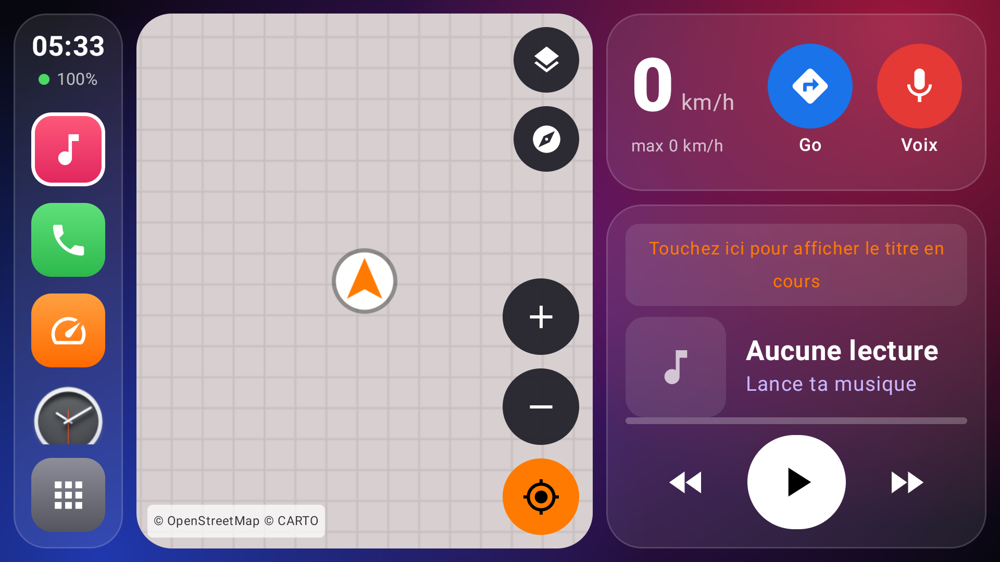

# MotoDash

Tableau de bord moto pour Android, façon CarPlay, directement sur l'écran du téléphone.

Disposition inspirée de CarPlay : fond dégradé, cartes en verre dépoli, gros boutons utilisables avec des gants.

- **Dock** (à gauche en paysage, en bas en portrait) : heure, batterie, état du GPS, et les icônes Musique, Appels, Compteur, puis tes applis préférées. La grille ouvre la liste des applis.
- **Carte GPS** au centre. Elle suit ta position avec une flèche orange. Trois styles : Voyager clair, OpenStreetMap ou sombre (bouton calques). Elle peut s'orienter vers ton cap.
- **Carte vitesse** : vitesse et vitesse max, avec deux gros boutons :
  - **Go** ouvre ton appli de navigation (Waze, Google Maps, Calimoto…). Un appui long permet d'en choisir une autre.
  - **Voix** lance l'assistant vocal.
- **Carte du bas**, au choix depuis le dock :
  - **Musique** : pochette (aussi en fond flouté), titre, artiste, barre de progression, précédent / lecture / suivant
  - **Appels** : contacts favoris en un seul appui, plus le clavier
  - **Compteur** : vitesse max, distance, durée, altitude, nouveau trajet
  - **Applis** : ajoute ou retire les applis du dock (appui long pour retirer)

L'écran reste allumé et l'appli s'affiche par-dessus l'écran verrouillé.

## Installer

1. Copie `MotoDash.apk` sur le téléphone et ouvre-le (autorise « Installer des applis inconnues »).
2. Au premier lancement, accepte la localisation.
3. Onglet Musique : touche le bandeau orange et active **MotoDash** dans « Accès aux notifications ». C'est nécessaire pour afficher le titre en cours. Les boutons lecture et suivant fonctionnent même sans cette autorisation.

## Afficher une autre appli dans la moitié de l'écran

Android ne permet pas à une appli d'en afficher une autre *à l'intérieur* de sa propre fenêtre. On passe donc par l'écran partagé d'Android :

1. Ouvre MotoDash, puis le menu **Récents** (le carré, ou un glissement vers le haut en le maintenant).
2. Touche l'icône de MotoDash, puis **Écran partagé**.
3. Choisis l'autre appli.

Une fois MotoDash en écran partagé, les applis lancées depuis le dock ou le bouton Go s'ouvrent automatiquement dans l'autre moitié.

## Compiler

```bash
./gradlew assembleRelease   # → app/build/outputs/apk/release/app-release.apk
```

## Aperçu



*(Carte vide sur la capture : l'émulateur de test n'avait pas accès à Internet.)*
